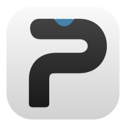

<p align="center">
  
</p>

<h1 align="center">Paul Notch</h1>

<p align="center"><strong>Your AI usage, right at the notch.</strong></p>

<p align="center">
  A native, local-first macOS dashboard for AI quotas, balances, and reset times.
</p>

## 这是什么

Paul Notch 把分散在不同 AI 产品里的额度、余额和重置时间，放到 Mac 刘海旁边。

平时抬头看一眼；点击展开，查看全部账户。会员百分比、API 钱包金额和配音积分分别展示，不把不同计费方式混成一个数字。

这次源码更新同步至已验收的 **1.0.0 / build 124**。公开仓库继续保留 `PaulNotch` 构建入口、现有工作区路径和独立的安全边界。重点是**轻量、真实额度和抬头即读**，不是增加更多工具。见 [本次更新](docs/RELEASE_NOTES_BUILD124.md)。

## 能做什么

- **自适应额度首页**：紧凑圆角便当盒卡片，按账户数量适配默认面板；可拖动排序、移除和加回，不会因隐藏卡片删除连接。
- **统一黑色面板**：展开顶边直接贴合屏幕；烟熏石墨卡片保留品牌图标和低额度警示，不添加逐卡片模糊或动态反射。
- **菜单栏自动让位**：鼠标进入菜单栏，紧凑刘海两侧自动收缩；离开立即开始恢复。物理刘海中间点击或 P 菜单打开面板。展开面板占据的菜单栏区域需收起后访问。
- **可视化连接**：在刘海内选择产品，填写 API Key 或完成官方登录，再核对读取结果。不需要把密钥交给 AI 或写进配置文件。
- **持续更新**：已连接查询源通常约 30 秒更新，收起面板不会停止同步。失效、离线和未连接状态不会用示例值冒充真实额度。
- **跟随应用与模型**：在明确开启并授予辅助功能权限后，识别 Cursor 桌面端及 Chrome 中官方 Cursor Agents 页的模型选择器，切到相应额度池。Auto / 未识别保留双额度；其他网页不猜测。
- **刘海与悬浮球**：78pt 玻璃液体球保留双额度，拖动速度驱动有界水体惯性；松手渐平，原生微气泡缓慢上升。拖回顶部或双击可飞回原位。隐藏、低电量及减少动态效果均限制装饰运动，不使用常驻网页或录屏来绘制水球。
- **双额度同屏**：豆包工作在首页、刘海和球内同时显示「5 小时」与「7 天总额」，各自对应真实重置时间。API 金额不伪装成百分比水位。
- **重置提醒**：区分账户周期与第三方公告，展示来源和北京时间；开启醒目提醒后，在适用的 24 小时 / 1 小时节点或发现明确公告时提示。消息查询不调用模型、不消耗模型 Token。
- **自助接入 API**：支持 OpenRouter 钱包预设及受限的自定义 HTTPS 额度查询，先读取真实响应、选择数值与单位、预览，再保存。不是任意模型 API 都能查询余额。
- **Codex 状态**：显示独立额度窗口、本机任务数和完成提醒；其他产品没有验证的任务来源时不显示猜测数量。
- **任务与备忘**：快速创建任务，补充多行说明、分类、优先级、日期和子任务。
- **随笔记**：记录多行文本，保留草稿，支持分类、搜索和可恢复删除。
- **本地时间规划**：记录目标和下一步行动，保存规划草稿；不会自动把内容发送给模型。
- **复制记录**：按类型显式开启，可暂停，默认不采集。
- **专注计时**：从首页直接开始或调整番茄钟。
- **音乐控制**：在用户授权后读取并控制 QQ 音乐的基本播放状态。
- **展示模式**：投屏时隐藏工作区，鼠标在原位置停留后才临时显示。
- **可调整工作区**：顶部功能和任务分类可拖动排序。

任务、笔记、音乐等工具保留在「更多功能」，额度首页不再被大量工具入口占据。

## 产品与连接方式

| 产品 | 输入 / 授权 | 显示内容 |
| --- | --- | --- |
| Codex | 本机已登录 Codex 的只读状态 | 独立额度窗口、重置时间、本机任务 |
| Cursor | 自行完成官方账户授权 | Cursor / 其他模型额度及对应周期 |
| Grok Bot | 使用已连接的 Cursor 账户 | Cursor 中 Grok 的额度；不是独立 SuperGrok 会员 |
| 豆包工作 | 在应用内完成官方登录 | 当前时段、近 7 天及各自重置时间 |
| Meta Muse | 在应用内完成官方登录并验证额度 | 每周额度、重置日期、额外购买词元及独立有效期 |
| DeepSeek API | API Key | API 钱包金额及币种 |
| MiniMax 中国站 API | 中国站 API Key | 人民币钱包；不与 Audio 会员混用 |
| MiniMax Audio | 配音账户官方登录 | 声贝 / 官方用量；适配器已有，真实账户持续同步仍需验收 |
| OpenRouter / 自定义额度 API | HTTPS 额度接口及可选 Header Key | 从实际 JSON 字段映射金额、百分比、积分或 Token；日期须有真实来源 |

没有官方剩余值或重置日期时显示未知，不根据购买价格或调用次数推算。网站会员不是通用 OpenAI-compatible API；任意 Base URL 不等于能读取会员余额。

## 设计原则

- 本地优先，不内置遥测或广告。
- 剪贴板、录音和第三方服务都需要明确开启。
- 密钥保存在 macOS Keychain，不写入工作区文件。
- 状态不可靠时显示错误，不用伪造数据营造“已连接”。

## 当前状态

这是 **source-first** 更新：源码、隔离回归测试和本地打包脚本已公开，**不是** Apple Developer ID 签名并公证的通用下载包。个人开发版的本机验收不等于每位用户的账户都已连接。

网站登录使用本应用独立的持久化 WebKit 配置（macOS 14+），不导入其他应用或浏览器的 Cookie。首次成功连接后正常退出和重开恢复已有连接；官方过期、撤销授权或主动断开后仍需重新登录。临时预览不持久保存个人登录。

以下功能受本机环境限制：

- Codex 额度与任务状态来自本机可用数据，不是跨设备的官方实时仪表盘。
- Cursor 网页识别目前仅实现 Chrome 的官方 `cursor.com/agents` 页面；选择器不是后台实际运行模型的证明，也不能证明浏览器与 Paul 登录的是同一账户。
- 公告来自 AIHOT 的公开 JSON 聚合源，约 10 分钟查询一次；有采集/网络延迟，不能保证发布瞬间送达，也不把公告当作个人额度到账。
- QQ 音乐控制依赖 macOS 辅助功能/自动化权限和第三方播放器的界面结构。
- 录音转写需要用户自行配置服务；项目不会读取浏览器 Cookie。
- 链接可以本地保存和打开；公开 1.0 暂不自动联网读取网页标题或图标。
- 临时显示的刘海依然可能出现在屏幕共享中，展示模式不等于捕获排除。
- API 凭证组件的固定证书配置属于维护者的个人发行配置。自行编译不会获得维护者身份或凭证；不同签名的更新可能需要一次新的 Keychain 授权，不能承诺所有自签构建都免授权。参见 [连接与发行说明](docs/QUOTA_CONNECTIONS.md)。

## 开发

应用运行目标仍为 macOS 13+；从源码构建需要 **Swift 6.2+**（Xcode 26+ 或对应 Command Line Tools）。CI 使用 Xcode 26.3，不依赖运行镜像默认选中的旧工具链。

```bash
git clone https://github.com/wzy11p/Paul-Notch.git
cd Paul-Notch
swift build
swift test
zsh scripts/test-public-runtime.sh
zsh scripts/test-public-boundaries.sh
zsh scripts/test-public-custom-quota.sh
# 多组独立回归及附加验证；原生 UI 组需要交互式 macOS 会话
zsh scripts/test-adversarial.sh
swift run PaulNotch
```

生成 `.app` 包：

```bash
# 仅用于本机试用；重新构建后系统权限可能需重新授予
zsh scripts/build-app.sh --adhoc

# 或使用你自己的稳定代码签名身份
zsh scripts/build-app.sh --identity "Apple Development: Your Name (TEAMID)"
```

输出位于 `dist/Paul Notch.app`。打包脚本不会自动安装、修改系统权限或迁移数据。

仅安装 Command Line Tools 时，`swift test` 可能只构建测试 target、执行 0 个 XCTest。独立回归脚本实际运行验证，不能把「测试构建成功」写成「所有 XCTest 通过」。更新范围见 [build 124 更新说明](docs/RELEASE_NOTES_BUILD124.md)（[上一版](docs/RELEASE_NOTES_BUILD109.md)）。

## 数据与权限

默认工作区位于：

```text
~/Library/Application Support/Paul Notch
```

首次使用摄像头、麦克风或音乐控制时，macOS 会要求相应权限。请只为你信任的构建授权。安全问题报告方式见 [SECURITY.md](SECURITY.md)。

## 来源与许可

Paul Notch 是基于 IslandMemo 继续开发的个人开源分支，并包含对 TO-DO Panel、CodexFloat 等 MIT 项目的适用改编。项目以 [MIT License](LICENSE) 开源；完整来源和版权说明见 [THIRD_PARTY_NOTICES.md](THIRD_PARTY_NOTICES.md)。

第三方产品图标和商标属于各自权利人，不代表官方合作，也不随源码重新授予 MIT 许可。[图标来源](Resources/ProviderLogos/SOURCES.md) 单独记录。

## Contributing

Issues and pull requests are welcome. Please read [CONTRIBUTING.md](CONTRIBUTING.md) before submitting changes.
